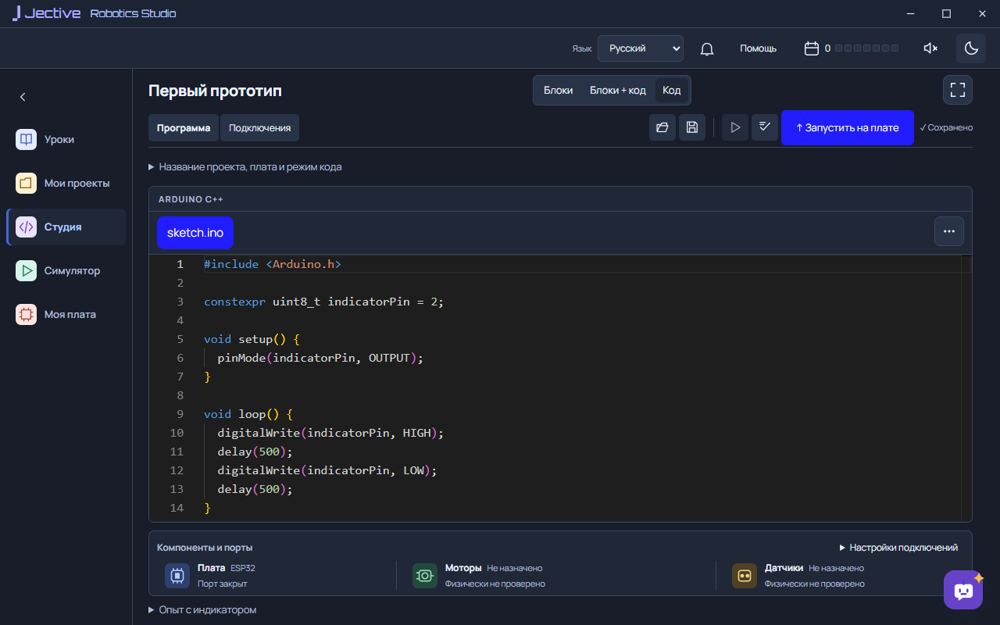
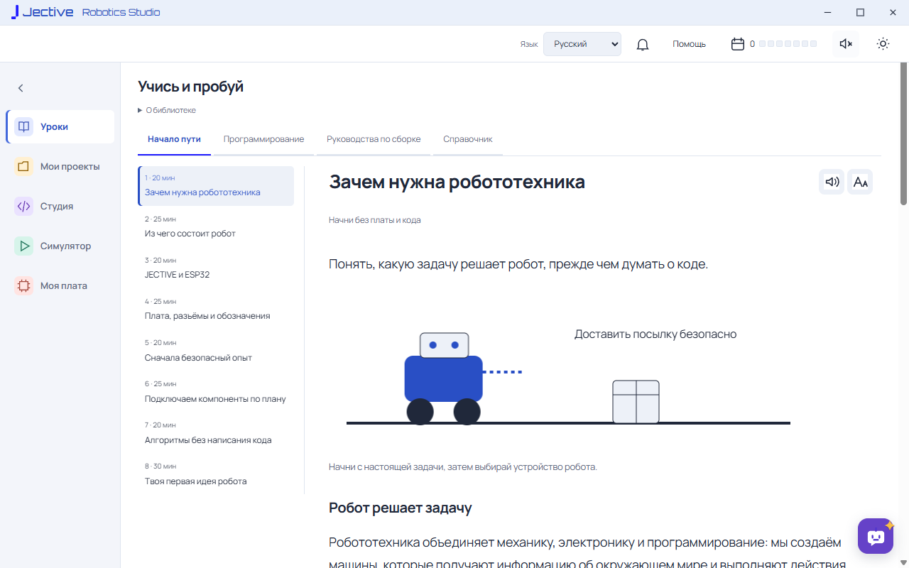

# JECTIVE Robotics Studio

Настольное приложение для самостоятельного изучения робототехники: от первых понятий и интерактивных заданий до блочного программирования, Arduino C++ и испытаний робота в симуляторе.

Проект образовательной экосистемы **JECTIVE** · [jective.kz](https://www.jective.kz/)

**Статус: активная разработка.** Версия в `package.json` — `0.8.18`. Исходный код содержит более поздние изменения, чем ранее собранные установщики. Полная приёмка продукта ещё не завершена.

Физическая плата и набор JECTIVE пока не изготовлены. Приложение развивается независимо от оборудования; существующие профили ESP32 — справочные, а не характеристики будущей платы. Интеграция набора предусмотрена после получения его спецификации и образца.

## Интерфейс

Студия в тёмной теме: учебный пример открыт как локальный проект.



<details>
<summary>Вводный урок в светлой теме</summary>



</details>

## Возможности

- **Обучение:** 8 вводных уроков и 60 черновиков курса, теория, фотографии, тематические схемы, интерактивные иллюстрации и задания с локальной проверкой.
- **Окно приложения:** собственная панель управления окном, сворачиваемое меню, цветные значки и плавающий чат, который сохраняет диалог.
- **Запуск:** белый логотип на синем фоне и меняющаяся мысль из [локальной библиотеки мотивации](docs/LAUNCH_MOTIVATION.md).
- **Студия:** Blockly, генерация Arduino C++, редактор Monaco, проекты из нескольких файлов, сворачиваемая навигация и просмотр подключений компонентов.
- **Симулятор:** игровые карты и воспроизводимые сценарии поведения робота. Произвольный Arduino C++ в нём не исполняется.
- **Проекты:** локальное сохранение, список с датами, поиск, версии и восстановление.
- **Доступность:** отдельное увеличение кода (Ctrl+колесо, Ctrl+/−, сброс Ctrl+0), размер и интервалы текста, компактные кнопки озвучивания, режим уменьшенного движения. Иллюстрации приостанавливаются вне видимой области.
- **Языки:** русский, казахский и английский интерфейс. 136 локальных аудиозаписей теории на русском и английском работают без ИИ и интернет-запросов.
- **Помощник:** полноценный чат через сервер JECTIVE; общий ключ OpenAI не передаётся ученикам.
- **Аппаратный режим:** отдельные команды компиляции и загрузки через Arduino CLI. Предварительный профиль JECTIVE не разрешает работу с неподтверждённым оборудованием.

Уроки требуют независимой технической и языковой проверки. Казахские аудиозаписи пока отсутствуют. Успешная симуляция или компиляция не подтверждает работу физического робота.

## Быстрый запуск

Для настольного приложения нужны **Windows x64, Node.js 24 и npm**. Установка зависимостей требует интернета, если они ещё не находятся в локальном кеше.

```powershell
npm ci
npm start
```

Команда собирает приложение и запускает Electron. Отдельный веб-сервер не нужен. Уроки, редактор, проекты и симуляция работают без онлайн-помощника.

Компиляция требует отдельно подготовленных Arduino CLI, ядра ESP32 и библиотек. Они не хранятся в Git. Инструкции: [подготовка инструментов](docs/TOOLCHAIN.md) и [развёртывание приложения](docs/DEPLOYMENT.md).

## Сервер ИИ

Сервис находится в [`services/assistant`](services/assistant/README.md) и требует Node.js 24 без дополнительных npm-зависимостей.

```powershell
npm run assistant:test
# После настройки серверных переменных:
npm run assistant:start
```

Ключ OpenAI хранится на сервере в зашифрованном AES-256-GCM файле. Мастер-ключ хранится отдельно. Ученикам выдаются индивидуальные токены со сроком действия и квотами; на Windows приложение сохраняет их через Electron `safeStorage`. Настройки провайдера и общий ключ недоступны в ученическом интерфейсе.

Сервис слушает только `127.0.0.1`; публичный доступ организуется через HTTPS-прокси. Готовы шаблоны nginx/systemd, инструкции выдачи токенов и ротации ключа: [руководство администратора](services/assistant/DEPLOYMENT_RU.md). Реальный сервер, домен, сертификат и платные запросы OpenAI пока не проверены.

Первичная настройка устройства использует `JECTIVE_ASSISTANT_SERVER` и `JECTIVE_ASSISTANT_TOKEN`. **Общий ключ OpenAI на ученическом устройстве не нужен.** Настольное приложение не загружает `.env` автоматически. В ИИ отправляются вопрос, ограниченная история и только явно выбранный контекст проекта.

## Проверки

```powershell
npm run typecheck
npm run lint
npm test
npm run architecture:test
npm run assistant:test
npm run security:audit
npm run build
```

Дополнительные проверки: `npm run test:coverage`, `npm run audio:test`, `npm run requirements:check`, `npm run test:e2e`, `npm run content:validate`, `npm run firmware:check`.

Часть E2E/компиляторных сценариев требует подготовленного SDK и выполняется долго. Проверка содержания сохраняет незавершённые требования к ручной экспертизе; её нельзя считать подтверждением качества уроков.

На 15 октября 2026 года прошли 580 доменных тестов, 14 серверных и 2 архитектурных теста, сборка, TypeScript и линтер. Аудит не сообщил известных уязвимостей зависимостей. Первый полный прогон интерфейса завершился с ошибками (69 прошли, 82 не прошли, 1 пропущен). Во втором независимом снимке: 147 прошли, 7 не прошли, 2 пропущены; исправленные сценарии проверялись отдельно. В итоговой локальной r5 также проверены настоящая компиляция минимального проекта и восстановление после перезапуска. Это результаты отдельных проверок, а не сертификат безопасности или готовности релиза. Подробнее: [результаты и ограничения](docs/VERIFICATION.md).

## Структура

| Каталог | Назначение |
| --- | --- |
| `apps/desktop` | Electron main, ограниченный preload, интерфейс React и фоновые workers |
| `packages` | Контракты, профили оборудования, генерация кода, симуляция, хранение и учебный контент |
| `services/assistant` | Сервер помощника, секреты, квоты и шаблоны развёртывания |
| `assets` | Логотипы, шрифты, фотографии и локальная озвучка |
| `firmware` | Исходники робототехнического runtime |
| `tests` | Доменные, интеграционные, серверные и Electron-тесты |
| `scripts` | Сборка, проверки архитектуры, контента и инструментов |
| `docs` | Архитектура, требования и инструкции |
| `evidence` | Текстовые результаты и выбранные свидетельства проверок |

Системные операции, файлы и аппаратное взаимодействие остаются в main/domain-службах. Интерфейс работает через ограниченный IPC с проверкой контрактов. Транзитивные импорты системных модулей в renderer/workers проверяются перед сборкой.

Подробнее: [архитектура](docs/ARCHITECTURE.md), [модель угроз](docs/THREAT_MODEL.md), [будущий набор](docs/FUTURE_HARDWARE.md), [матрица требований](docs/requirements.json).

## Установщик Windows

```powershell
npm run package
```

Для упаковки нужен подготовленный Arduino CLI в `.toolchain/bin`. Результат NSIS создаётся локально в `release/`; сборки и инструменты исключены из Git.

Windows 10, полный цикл установки/обновления/удаления, подпись установщика и будущий физический набор ещё требуют проверки. Создание EXE само по себе не означает готовность к распространению.

Перед выпуском пройдите [сценарии приёмки](docs/RELEASE_ACCEPTANCE_RU.md): установщик, самостоятельная работа учеников, доступность, сервер, скорость сборки и физический набор. [Передача проекта](docs/HANDOFF.md) указывает текущую проверенную сборку и оставшиеся ограничения.

## Работа с репозиторием

`package-lock.json`, исходники, тесты и необходимые учебные ресурсы сохраняются в Git. `.gitignore` исключает зависимости, SDK, сборки, локальные базы, ключи, токены и временные отчёты. Шаблоны `*.env.example` содержат только настройки без секретов.

Большие локальные трассы и скриншоты проверок не публикуются. Текстовые результаты и файлы, необходимые матрице требований, сохраняются; некоторые исторические ссылки в отчётах ведут на локальные материалы, отсутствующие в GitHub. Они не удалены с рабочего компьютера.

Перед публикацией используйте [памятку подготовки к GitHub](docs/GITHUB.md). Не включайте ученические данные, реальные ключи или серверную конфигурацию в коммиты.

## Лицензия

Проект обозначен как **UNLICENSED**: публикация исходников не предоставляет открытую лицензию. Сторонние библиотеки, шрифты, фотографии и другие ресурсы сохраняют собственные лицензии и уведомления в `assets/licenses` и документации ресурсов.
