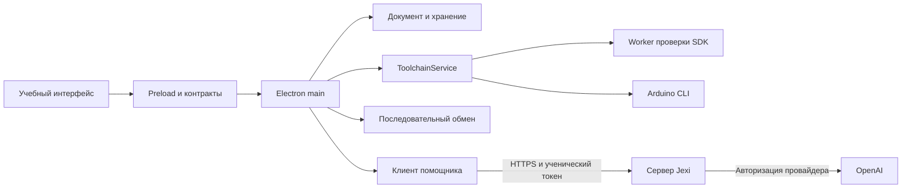

# Как устроен JECTIVE Robotics Studio

Приложение разделяет учебный интерфейс, хранение работ, инструменты сборки, обмен с устройствами и сервер помощника. Это позволяет развивать обучение сейчас и подключить настоящий набор после получения его спецификации. Предварительный профиль JECTIVE не является проверенной аппаратной конфигурацией.

## Основные части

| Часть | Ответственность |
| --- | --- |
| [Интерфейс](../apps/desktop/renderer) | Уроки, Blockly, Monaco, симулятор, проекты и чат. Не получает ключ OpenAI и не работает с системными файлами напрямую. |
| [Контракты](../packages/contracts) | Форматы проектов и сообщений IPC, ограничения входных данных. Эти модули остаются пригодными для изолированного браузерного кода. |
| [Electron main](../apps/desktop/main.ts) | Проверяет отправителя запросов, управляет нативными диалогами и координирует системные службы. |
| [Инфраструктура desktop](../apps/desktop/infrastructure) | Жизненный цикл операций и worker, привязка открытого документа, системные адаптеры и конфигурация. |
| [Хранение](../packages/persistence) | SQLite, автосохранение, версии, резервные копии, ограниченные JSON/ZIP-чтения и экспорт. |
| [Инструменты сборки](../packages/toolchain) | Проверка SDK, фиксированные вызовы CLI, снимки исходников и бинарных файлов, журнал процесса. |
| [Профили](../packages/profiles) и [устройства](../packages/devices) | Версии аппаратных описаний, возможности выводов, назначения компонентов, последовательный обмен и кадры протокола. |
| [Учебное содержание](../packages/content) | Теория, задания, проверяемые модели и материалы курса. Фотографии и локальные аудиозаписи поставляются с приложением. |
| [Сервер помощника](../services/assistant) | Ключ провайдера, авторизация учеников, ограничения запросов, квоты и обращение к OpenAI. Развёртывается отдельно от ученического EXE. |

Схема показывает направление запросов. Результаты и события возвращаются через проверяемые контракты.

Симулятор исполняет поддерживаемую учебную модель, а не произвольный Arduino C++. Успешная симуляция или компиляция не подтверждает работу реальных моторов и датчиков.

## Открытие и сохранение работы

Путь внешнего файла выбирается нативным диалогом. `DocumentSession` готовит проверенный кандидат, сохраняя прежнюю привязку документа. Интерфейс предварительно проверяет Blockly в отдельном рабочем пространстве и подтверждает принятие именно этого кандидата. Только после подтверждения меняется активная работа. Запоздалый ответ не должен подменять уже открытый другой проект.

Внешнее JSON-сохранение и локальное автосохранение выполняют разные задачи. Первое записывает выбранный пользователем файл с контролем ревизии через уникальный временный файл и замену. Второе сохраняет восстановительную копию в SQLite. Автосохранение не должно молча перезаписывать внешнюю копию.

Чтение ограничивается до разбора JSON. Архив `.jective` имеет проверяемый частный формат; его содержимое не распаковывается в произвольные системные пути. Повреждённые данные не являются поводом незаметно заменить работу пустым проектом. При восстановлении резервной копии проверяются структура и записи базы; сохраняется предыдущая база.

## Сборка и подготовка загрузки

1. Проверяется проект, привязанный аппаратный профиль и допустимость имён дополнительных файлов. `build_opt.h` запрещён без учёта регистра: ESP32 использует это имя для параметров сборки, а не как обычный заголовок.
2. Проверяются версии CLI и поддержки платы. Worker вычисляет хеш содержимого CLI, выбранного core, всех установленных tools и пользовательских библиотек. Используются восемь потоков, ограниченная очередь результатов и отсортированный порядок обхода. Кэш по одним временам изменения не заменяет чтение байтов.
3. Для операции создаётся отдельный каталог с точными исходниками. CLI вызывается с фиксированными аргументами без shell. После успешной компиляции SDK проверяется повторно; изменение среды не публикует пригодный для загрузки результат.
4. [Снимок сборки](../packages/toolchain/build-snapshot.ts) проверяет бинарные файлы потоково. Манифест ограничен 4 МиБ; набор результатов — 256 файлами, 1 ГиБ на файл и 4 ГиБ суммарно. Проверяются тип, идентичность, размер и изменение файла во время чтения.
5. Перед загрузкой нужен успешный актуальный результат этого проекта в текущем сеансе. Манифест читается один раз. Долгая проверка SDK выполняется **до окончательной проверки бинарных файлов и исходников**, чтобы обнаружить их изменение во время ожидания. После этого вызывается загрузчик для выбранного порта.

Последовательность проверок сокращает окно между проверкой файлов и их использованием; она не устраняет все межпроцессные файловые гонки. Нативный компилятор и SDK не являются песочницей для недоверенного ПО. Физическая загрузка на будущую JECTIVE-плату пока не проверена.

Данные о ходе проверки имеют отдельный контракт: количество проверенных файлов, объём и прошедшее время. Они не являются доказательством успешной сборки. Проценты без известного общего объёма не вычисляются. Частые обновления счётчиков не объявляются экранным диктором; основные этапы отображаются отдельно.

## Помощник и секреты

Ученическое приложение использует адрес JECTIVE и отдельный токен. Зашифрованная локальная запись связывает токен с адресом сервера: правка адреса не должна перенаправлять сохранённый токен на другой endpoint. Ключ OpenAI и выбор модели находятся на серверной стороне.

Код передаётся с явным согласием и предварительным просмотром выбранного контекста. Предложенный код проходит отдельное рассмотрение перед применением. Ответ помощника не запускает компиляцию или устройство автоматически. Состояние запроса связано с исходной версией работы, чтобы устаревший ответ не подменял более новые изменения.

Серверная доступность, реальные расходы, резервное восстановление и сохранение облачной квоты требуют отдельной эксплуатационной проверки. Один успешный ответ модели не подтверждает все эти свойства.

## Как вносить изменения

Расширение аппаратного набора начинается с описания проверенной ревизии и версионированных контрактов. Не добавляйте GPIO, электрические ограничения или протокол в React-компонент как догадку. Новые драйверы и адаптеры должны сохранять проверку профиля, обработку ошибок и отмену операций. [Что потребуется от будущей платы](FUTURE_HARDWARE.md).

`architecture:check` проверяет транзитивные зависимости renderer, preload и workers и выполняется перед сборкой. Нативные импорты в браузерный граф запрещены. Это статическая граница, дополняющая CSP, sandbox и проверки IPC, а не самостоятельная гарантия безопасности.

Для изменения нужны проверки соответствующего уровня: доменные для правил и файловых границ, UI для поведения ученика, фактический EXE для упаковки. Проверка компилятора, установка и физический набор дают разные свидетельства. [Текущий протокол](VERIFICATION.md) фиксирует выполненное; [план приёмки](RELEASE_ACCEPTANCE_RU.md) — оставшиеся условия. Подробности устойчивых форматов сохранены в [техническом описании](ARCHITECTURE.md), границы защиты — в [SECURITY.md](../SECURITY.md).
